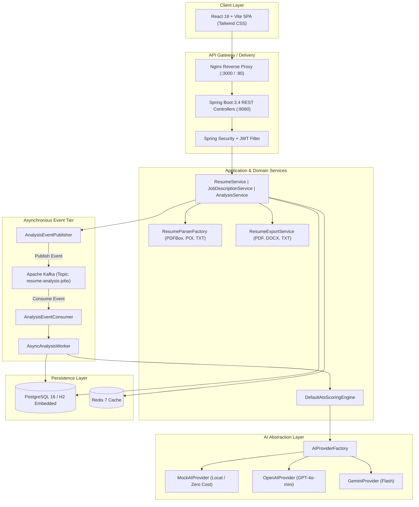
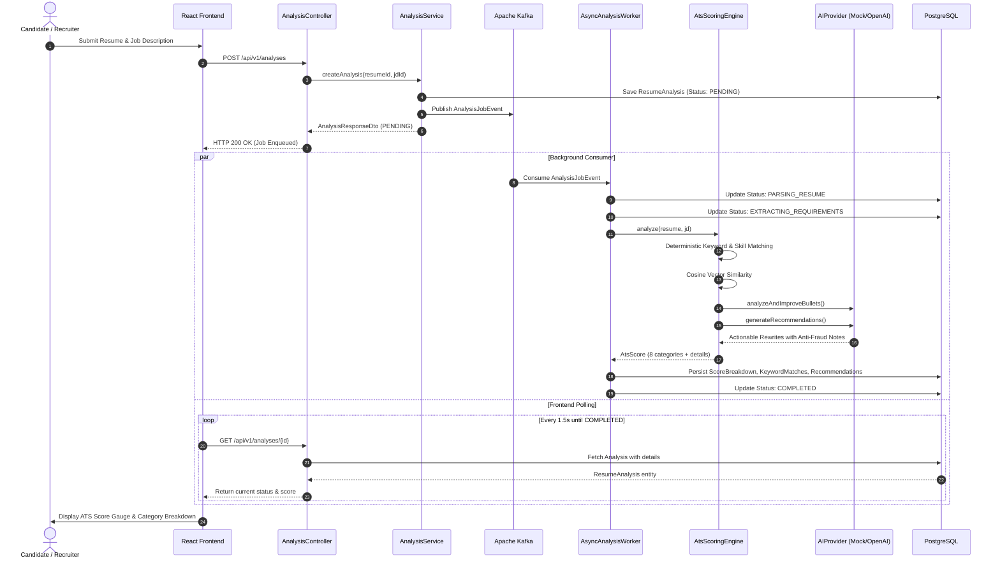

# ARCHITECTURE.md — Technical Architecture & System Design

## 1. High-Level System Architecture

ResumeMatch AI follows **Clean Architecture** and SOLID principles, decoupling delivery mechanisms (REST/Web), core business domains (ATS Scoring & Parsing), and infrastructure adapters (PostgreSQL, Kafka, Redis, AI Providers).



---

## 2. ATS Scoring Engine Algorithm

Unlike black-box LLM prompt scoring, ResumeMatch AI utilizes a **hybrid deterministic and semantic scoring engine**:

$$\text{ATS Score} = \sum_{i=1}^{8} (W_i \times S_i)$$

Where:

| Component ($i$) | Weight ($W_i$) | Evaluation Method | Key Criteria Checked |
|---|---|---|---|
| **Keyword Match** | 25% | Deterministic + Stemmed Lexical | Ratio of matched JD keywords; direct match (100%), related concept (70%), missing (0%). |
| **Required Skills** | 20% | Must-Have Rule Engine | Compliance with mandatory skills (e.g. "5+ years Java", "must have Kafka"). |
| **Experience Alignment** | 15% | Heuristic Range Matcher | Candidate's cumulative career years vs required seniority threshold. |
| **Job Title Alignment** | 10% | Lexical & Headline Scan | Correlation between target role title and candidate summary/experience headers. |
| **Semantic Similarity** | 10% | Cosine Vector Similarity | Term-frequency vector alignment between resume accomplishments & JD responsibilities. |
| **Resume Structure** | 10% | Section Pattern Parser | Presence of standard ATS headers (Summary, Skills, Experience, Education). |
| **Achievement Quality** | 5% | Syntactic Pattern Classifier | Frequency of active verbs (Architected, Developed) and quantifiable numerical metrics. |
| **Formatting Compatibility** | 5% | Layout Anomaly Detector | Penalties for table grids, multi-column tab alignments, graphics, and missing text streams. |

All weights are configurable via `app.scoring.weights` in `application.yml`.

---

## 3. Analysis Execution Flow (Sequence Diagram)



---

## 4. Document Parsing & Layout Inspection Architecture

```text
Uploaded File (Multipart / Stream)
   │
   ├── .pdf  ──► PdfResumeParser (Apache PDFBox 3.x)
   │               - PDFTextStripper (position sorted)
   │               - Scanned PDF detection
   │               - Encryption check
   │
   ├── .docx ──► DocxResumeParser (Apache POI 5.x)
   │               - XWPFParagraphs text stream
   │               - Table cell scanner & warning flag
   │
   └── .txt  ──► TxtResumeParser (Standard I/O UTF-8)
   │
   ▼
ResumeTextParserHelper
   ├── ContactInfo (Email regex, Phone regex, LinkedIn, GitHub)
   ├── Section Partitioning (Summary, Skills, Experience, Education)
   ├── Experience Chronology & Estimated Years Calculator
   └── FormattingInspection (Tables, Columns, Emojis, Readability)
   │
   ▼
ResumeContent (Normalized In-Memory Domain Model)
```

---

## 5. Export Architecture

Export generation avoids client-side canvas rasterization to ensure that documents produced by ResumeMatch AI are certified 100% machine-readable:

```text
ResumeContent Model
   │
   ├── TemplateType Selector:
   │     1. CLASSIC_PROFESSIONAL
   │     2. MODERN_MINIMAL
   │     3. SOFTWARE_ENGINEER
   │     4. EXECUTIVE
   │
   ├── PDF: PdfExportGenerator (Pure PDFBox Standard-14 Helvetica streams)
   ├── DOCX: DocxExportGenerator (Apache POI single-column clean styles)
   └── TXT: TxtExportGenerator (Clean ASCII/UTF-8 plaintext)
```
