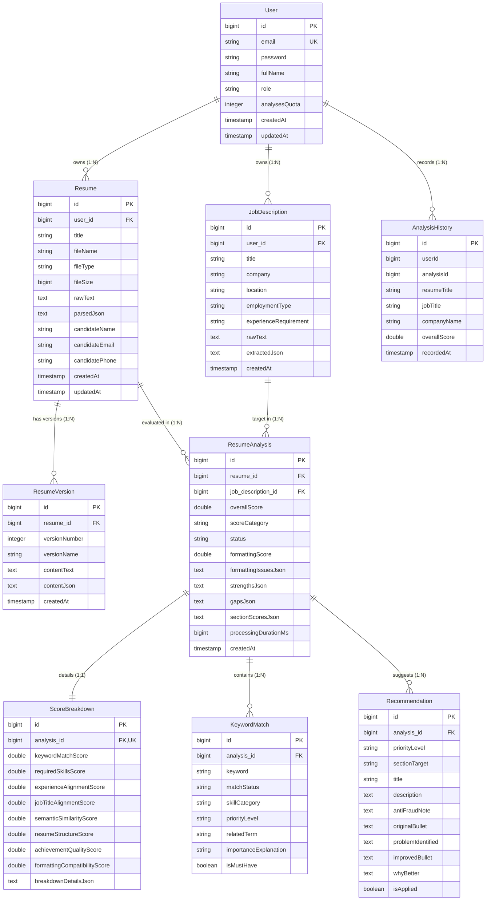

# DATA-MODEL.md — Data Model & Entity Specifications

## 1. Entity Relationship (ER) Diagram

---

## 2. Data Ownership & Bounded Contexts

| Entity | Primary Context Owner | Persistence Lifecycle | Deletion Policy |
|---|---|---|---|
| `User` | Identity & Auth | Master account record | Deleting User cascades to all owned resumes, analyses, and history. |
| `Resume` | Candidate Document Domain | Mutable per candidate, versioned | Deleting Resume cascades to all `ResumeVersion` and `ResumeAnalysis` records. |
| `ResumeVersion` | Resume Builder & Optimization | Immutable historical snapshots | Retained for candidate audit trail until parent resume is deleted. |
| `JobDescription` | Requisition Domain | Immutable job posting specification | Reusable across multiple candidate resume evaluations. |
| `ResumeAnalysis` | ATS Scoring Engine | Immutable evaluation outcome | Cascade deletes `ScoreBreakdown`, `KeywordMatch`, and `Recommendation`. |
| `AnalysisHistory` | Analytics & Audit Context | Lightweight denormalized audit record | Retained for quota and historical reporting. |

---

## 3. Storage Optimization & Indexing Strategy

1. **Unique Indexes**:
   - `users(email)`: Ensures single account per email address.
2. **Foreign Key Indexes**:
   - `resumes(user_id)`: Speeds up dashboard retrieval of candidate resumes.
   - `resume_analyses(resume_id, job_description_id)`: Accelerates evaluation lookups.
   - `keyword_matches(analysis_id)` & `recommendations(analysis_id)`: Quick joins for analysis rendering.
3. **Large Text Field (LOB) Storage**:
   - Resumes and Job Descriptions store raw text in PostgreSQL `TEXT` columns (out-of-line TOAST storage) to maintain compact primary index pages.
4. **Data Retention & Privacy Enforcement**:
   - User account deletion triggers strict cascading cleanup across `resumes` and `analyses`, ensuring full GDPR / CCPA right-to-be-forgotten compliance.
