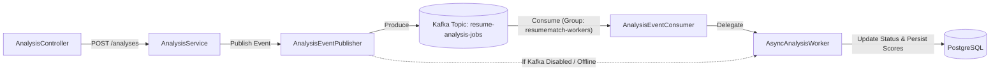

# EVENT-CATALOG.md — Apache Kafka Event Catalog

This document specifies all asynchronous event schemas, topics, producer/consumer topologies, and error-handling policies within ResumeMatch AI.

---

## 1. Topic Overview

| Topic Name | Partitions | Replication | Cleanup Policy | Purpose |
|---|---|---|---|---|
| `resume-analysis-jobs` | 3 | 1 (Dev) / 3 (Prod) | `delete` (7 days) | Dispatches newly requested resume analyses to asynchronous background workers. |
| `resume-analysis-dlq` | 1 | 1 (Dev) / 3 (Prod) | `delete` (14 days) | Dead-Letter Queue for corrupted documents or recurring unprocessable failures. |

---

## 2. Event Specifications

### Event: `AnalysisJobEvent`
- **Topic**: `resume-analysis-jobs`
- **Trigger**: Emitted whenever a user requests an asynchronous ATS evaluation via `POST /api/v1/analyses`.
- **Partition Key**: `analysisId` (ensures strict FIFO ordering for any given analysis lifecycle).
- **Format**: JSON (Serialized via Spring Kafka `JsonSerializer`).

#### Payload Schema
```json
{
  "analysisId": 42,
  "resumeId": 105,
  "jobDescriptionId": 88,
  "userId": 12,
  "timestamp": "2026-10-07T14:25:30.150Z"
}
```

#### Field Dictionary
| Field | Type | Required | Description |
|---|---|---|---|
| `analysisId` | Long | Yes | Primary key of the `ResumeAnalysis` record in `PENDING` state. |
| `resumeId` | Long | Yes | Primary key of the candidate's `Resume` record. |
| `jobDescriptionId` | Long | Yes | Primary key of the target `JobDescription` requisition. |
| `userId` | Long | No | Optional account owner identifier (null for guest trial requests). |
| `timestamp` | ISO-8601 String | Yes | UTC generation timestamp for latency observability. |

---

## 3. Producer & Consumer Topology



### Producers:
- `com.resumematch.kafka.AnalysisEventPublisher`
  - Enabled when `app.kafka.enabled=true`.
  - Automatically fails over to in-process `@Async` executor if Kafka broker is unavailable.

### Consumers:
- `com.resumematch.kafka.AnalysisEventConsumer`
  - Group ID: `resumematch-workers` (configured via `spring.kafka.consumer.group-id`).
  - Concurrency: 3 listener threads per worker instance.

---

## 4. Failure Handling & Idempotency

1. **Idempotent Processing**: `AsyncAnalysisWorker` checks the database status before executing. If an analysis is already in state `COMPLETED`, the consumer commits the offset and skips re-computation.
2. **Retry Policy**: 3 retry attempts with exponential backoff (1s, 2s, 4s).
3. **Dead Letter Queue (DLQ)**: Poison pills (e.g. malformed JSON or corrupted password-protected PDFs) are routed to `resume-analysis-dlq` after 3 failed attempts, updating the analysis database status to `FAILED`.
